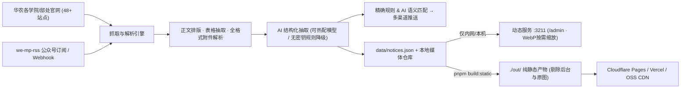

<div align="center">

# 「华农知道」SCAU Know

**华南农业大学校园通知、活动日历与微信公众号聚合平台**  
聚合二级学院与职能部处官网及公众号推文，提供全格式附件解析、AI 结构化抽取、个人关键词订阅提醒与开箱即用的动静分离 CDN 部署方案。


</div>

---

## 系统架构

采用 **「私有采集后台 + 公网纯静态 CDN（方案 B）」** 动静分离架构：抓取、附件解析、AI 调用与个人消息推送运行在本地或私有服务端；公网分发通过 `pnpm build:static` 物理剔除 `/admin`、`/sources`、`/api/*` 与原始大图，仅发布精简 HTML、WebP 缩略图与按条详情 JSON。



---

## 核心特性

### 1. 多源采集与微信公众号接入
- 覆盖 **华南农业大学主站、各二级学院及职能部处官网**，自适应 WebPlus、列表页及招聘系统等多种页面模板，内置增量游标、URL 规范化去重、防盗链图片镜像与 `dayDiffCst`（UTC+8）异常日期校准。
- 支持接入自建 **`we-mp-rss`** 服务（公众号文章链接识别、关键词搜索订阅、定时同步及实时 Webhook 推送）。

### 2. 深度正文与全格式附件解析
- **正文重排**：自动合并图文顺序块、识别并响应式渲染内嵌 HTML 表格（`TableBlock`，支持跨行/跨列表头），自动将仅含内嵌 PDF 播放器的通知（`wp_pdf_player` / `<iframe>`）提升为可读正文与摘要。
- **全格式附件抽取**：支持直传或伪装扩展名的魔数嗅探与编码自动识别（UTF-8 / UTF-16 BOM / GB18030），并支持在线「解析预览」：
  - **文档**：`.pdf`、`.ofd`、`.doc`、`.docx`、`.docm`、`.wps`、`.rtf`、`.odt`、`.txt`、`.md`、`.xml`（含伪装 HTML / MHTML 的 `.doc`）
  - **表格**：`.xlsx`、`.xls`、`.xlsm`、`.xlsb`、`.ods`、`.et`、`.csv`、`.tsv`（多工作表切换预览，规则匹配扫描全部行）
  - **幻灯片**：`.ppt`、`.pptx`、`.pptm`、`.ppsx`、`.dps`、`.odp`
  - **压缩包与图片**：`.zip` / `.rar` 递归提取包内文件清单、文档全文与电子表格；图片附件支持卡片内直接预览与原图灯箱。

### 3. AI 模型热配置与自动发现
- `/admin` 提供 **「AI 模型与解析」** 面板，修改后写入独立配置文件并即时热生效，无需重启服务：
  - 内置 **10 种 OpenAI 兼容预设**（DeepSeek、通义千问、智谱 BigModel、Kimi、硅基流动、Google Gemini、OpenAI、OpenRouter、Ollama 本地免密服务及自定义网关）；
  - 一键 **「自动获取模型」**（自动探测 `/models`、`/v1/models` 与 Ollama `/api/tags`，支持搜索过滤与一键选型）及在线连通性测试；
  - 支持全局开关、采样温度、超时时间、JSON Mode 开关与学校定制提示词，未配置密钥时无缝降级为内置确定性规则引擎。

### 4. 精准订阅监控与多渠道提醒
- 两阶段筛选：先用关键词 / 正则扫描标题、正文、PDF/Word 文本及 Excel 全部工作表行（精确到工作表名与行号），再可选结合 AI 语义相关性判定。
- 支持自定义 `{{placeholder}}` 消息模板，集成 **WxPusher、PushPlus、Server酱、Bark、飞书机器人、钉钉机器人、Resend 邮件与自定义 Webhook**。

### 5. 前端体验与性能优化
- 多维度视图：活动 / 通知双分区瀑布流（固定列分配无重排抖动）、周视图 + 全部排期活动日历、学科多选筛选、星标学院/来源、深浅色自适应主题与中英文界面切换。
- 性能流水线：
  - 基于 `sharp` 的服务端 WebP 缩略图按需裁剪与静态 `w640`/`w1200` 导出（大幅削减图片传输体积与首屏尺寸）；
  - 列表首屏传输轻量摘要，点击详情弹窗按需拉取 `/api/notices?id=...` 或 `/static-data/details/<id>.json`；
  - 首屏外板块采用 `content-visibility: auto` 延迟渲染，配合 `fetchPriority="high"` 首屏关键图调度、无状态滚动进度条与跨标签页自动同步。

### 6. 动静分离与安全部署
- 详细指南见 [DEPLOY.md](./DEPLOY.md) 与 [docs/deploy.md](./docs/deploy.md)：
  - 公网构建 `pnpm build:static` 物理删除 `/admin`、`/sources`、`/api/*` 及原始大图目录，内附 Cloudflare Pages [\_headers](./public/_headers) 与 GitHub Actions 自动部署工作流 [.github/workflows/deploy-static.yml](./.github/workflows/deploy-static.yml)。
  - 私有服务端支持 `ADMIN_SECRET`、`CRAWL_SECRET`、`WECHAT_WEBHOOK_SECRET` 全链路鉴权。

---

## 目录结构

```text
scau-know/
├── .github/workflows/          # GitHub Actions 静态构建与 Cloudflare Pages 部署工作流
├── docs/                       # 抓取接入与服务器/动静分离说明
├── public/                     # 静态图标、PWA 清单与 CDN 缓存头 (_headers)
├── scripts/                    # 采集、定时守护、AI 批处理、缩略图预热、静态导出与构建脚本
├── src/
│   ├── app/                    # Next.js App Router 页面 (/, /calendar, /category, /search, /sources, /admin, /api/*)
│   ├── components/             # 瀑布流卡片墙、详情弹窗、原图灯箱、后台控制台、日历等前端组件
│   ├── lib/
│   │   ├── ai/                 # 服务商预设、热配置持久化、/models 自动发现与大模型解析
│   │   ├── crawl/              # 多源抓取器、正文与表格抽取、全格式附件解析、定时调度器
│   │   ├── monitor/            # 监控规则、全量 Excel 行匹配引擎、模板渲染与多渠道推送
│   │   └── ...                 # 类型定义、格式化、来源元数据与静态导出逻辑
│   └── types/                  # 环境补充类型声明
├── DEPLOY.md                   # 方案 B（公网纯静态 CDN + 本地私有后台）操作指南
└── .env.example                # 环境变量配置模板
```

---

## 快速开始

### 1. 环境要求与安装

- Node.js `>= 20`（推荐 `22+`）
- `pnpm` `10.x`

```bash
git clone https://github.com/boooozhang2007/SCAU-Know.git
cd SCAU-Know
pnpm install
```

### 2. 配置环境变量

复制 `.env.example` 为 `.env.local` 并按需填写（`.gitignore` 已忽略 `.env*.local` 与本地运行数据）：

```bash
cp .env.example .env.local
```

若仅需本地体验，不填任何 API Key 即可启动（系统会自动退回演示数据或规则引擎）；接入真实抓取与公众号需配置 `WECHAT_MODE`、`WEMP_*` 及 `ADMIN_SECRET`。

### 3. 启动本地开发与私有后台

```bash
pnpm dev        # 启动开发服务，默认 http://localhost:3210
```

如需以生产模式在本机运行并打开后台：

```bash
pnpm build
pnpm exec next start -H 127.0.0.1 -p 3211
```

访问 `http://127.0.0.1:3211/admin` 即可管理公众号接入、AI 模型与自动获取列表、定时抓取周期、关键词监控与静态发布。

### 4. 构建纯静态 CDN 产物（方案 B）

```bash
pnpm crawl          # 抓取最新官网与公众号通知（可选）
pnpm build:static   # 输出纯静态站点到 ./out/
```

生成的 `./out/` 可直接通过 `wrangler pages deploy out`、Vercel CLI 或对象存储静态托管上线，具体自动化方案请参考 [DEPLOY.md](./DEPLOY.md)。

---

## 常用脚本

| 命令 | 说明 |
| --- | --- |
| `pnpm dev` | 启动本地开发服务器（端口 `3210`） |
| `pnpm build` | 编译 Next.js 生产服务 |
| `pnpm start` | 启动生产服务端 |
| `pnpm crawl` | 执行一次全量站点 + 微信抓取与附件解析 |
| `pnpm daemon` | 以独立后台进程运行定时抓取任务 |
| `pnpm enrich` | 批量对库内通知执行 AI / 规则结构化解析 |
| `pnpm setup:wemp` | 按配置批量发现并接入华农官方与校园公众号到 `we-mp-rss` |
| `pnpm optimize:thumbs` | 批量预生成封面图 `w640` WebP 缩略图缓存 |
| `pnpm reparse:attachments` | 清理误抓网页链接并重解析存量 `.doc` / `.zip` / `.rar` 等附件 |
| `pnpm export:data` | 导出前端精简摘要与分片详情 JSON 到 `public/static-data/` |
| `pnpm build:static` | 构建剔除后台与原图的纯静态站点到 `./out/` |
| `pnpm publish:static` | 导出静态快照并触发 Deploy Hook / GitHub Actions 重建 |

---

## 品牌与免责说明

- 站点标准绿 `#007848` 参考华南农业大学视觉形象识别系统色彩参数，站标为独立绘制的五瓣紫荆矢量图形，未使用学校官方校徽或标准字资产。
- 本项目为面向校园公开信息聚合与效率工具的独立开源项目，所抓取通知原文及附件版权归华南农业大学及各二级发布单位所有。
